<p align="center"></p>

<p align="center"><b>Your family's private YouTube — home videos and live streams, self-hosted.</b></p>

<p align="center">
  <a href="https://github.com/hardynetworks/kintube/actions/workflows/docker.yml"></a>
  
  
</p>

<p align="center">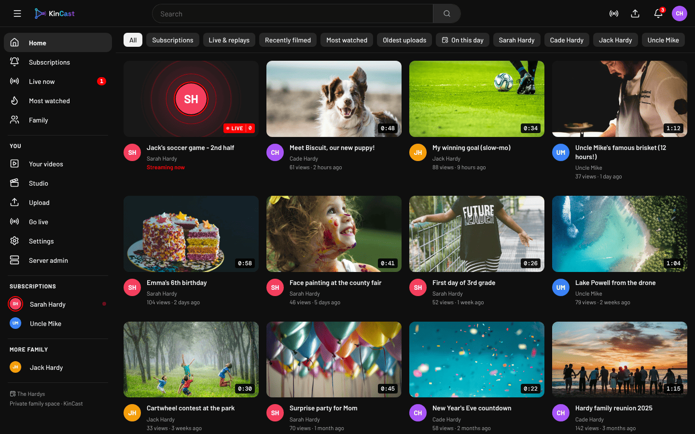</p>

KinCast is a place for the whole family to share home videos, watch them on any device, and go live for recitals, birthdays and games — with family chat. It runs on your own server in Docker. Nothing is public: every page, video and stream needs a family login.

Inspired by [Open Streaming Platform](https://github.com/Open-Streaming-Platform/open-streaming-platform) and [Owncast](https://owncast.online), rebuilt as its own app.

## Screenshots

<table>
  <tr>
    <td width="50%">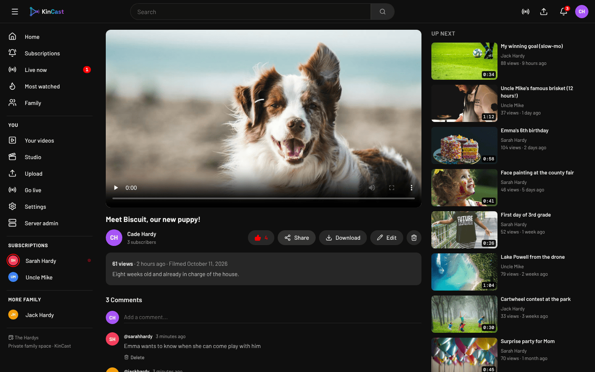<br><sub><b>Watch</b> — adaptive streaming, likes, comments, download the original, "Up next".</sub></td>
    <td width="50%">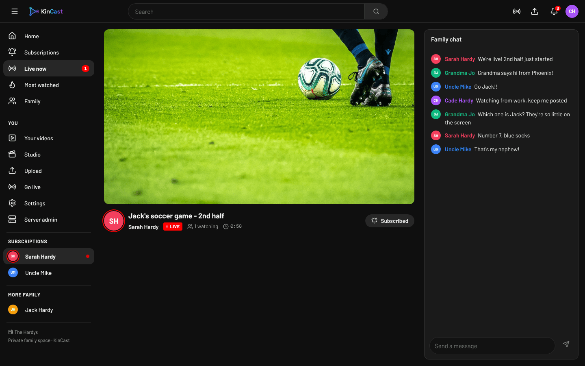<br><sub><b>Live</b> — stream from OBS or a phone, with family chat and a viewer count.</sub></td>
  </tr>
  <tr>
    <td>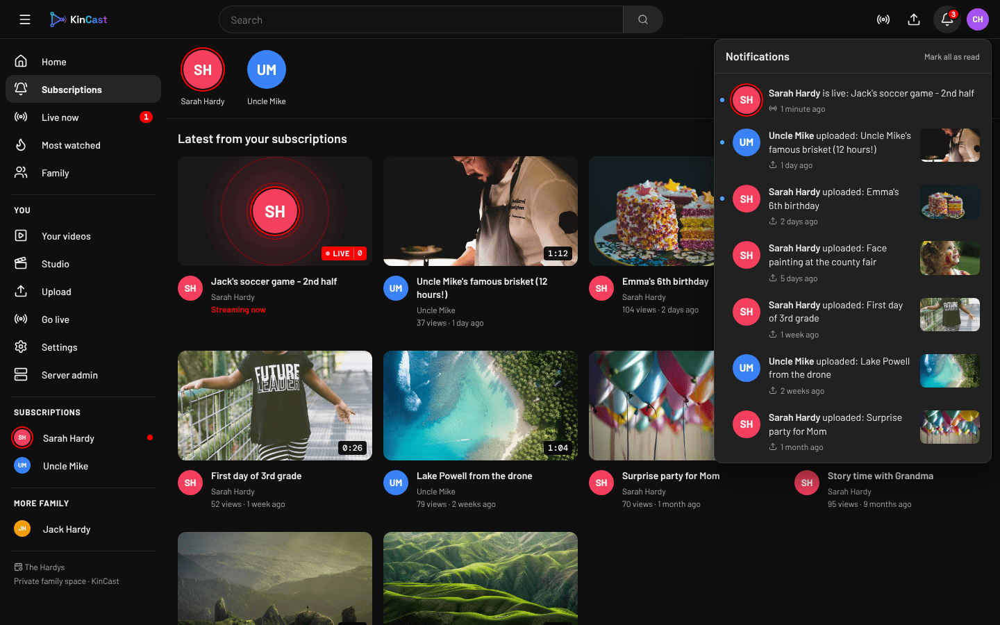<br><sub><b>Subscriptions & notifications</b> — follow family members; get alerted when they upload or go live.</sub></td>
    <td>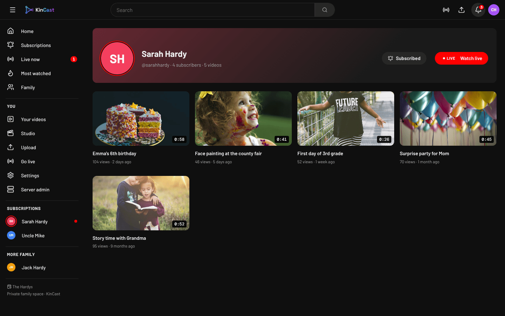<br><sub><b>Channels</b> — every family member gets their own channel.</sub></td>
  </tr>
  <tr>
    <td>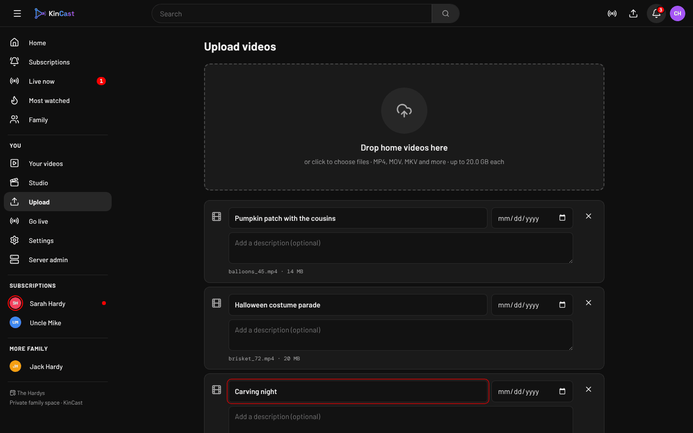<br><sub><b>Upload</b> — drop in many videos at once; titles and "date filmed" are filled in for you.</sub></td>
    <td>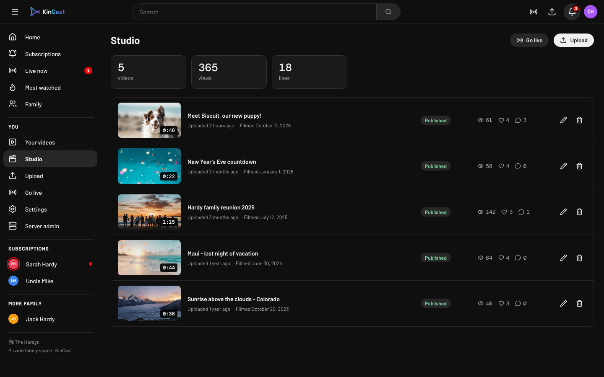<br><sub><b>Studio</b> — your videos, processing progress, views and likes.</sub></td>
  </tr>
  <tr>
    <td>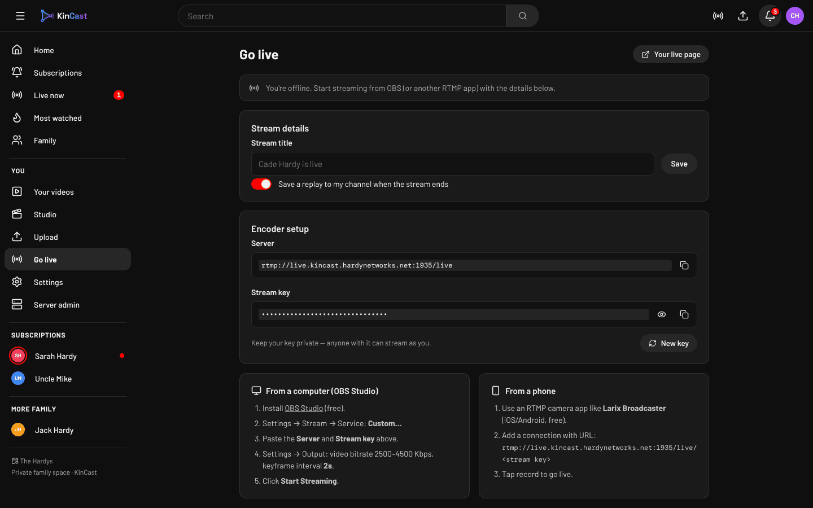<br><sub><b>Go live</b> — your server address and private stream key, with OBS and phone setup steps.</sub></td>
    <td>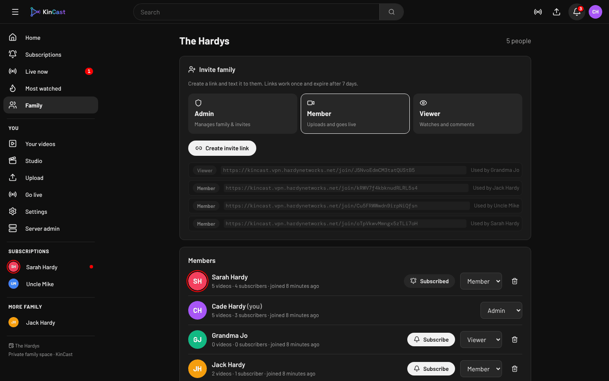<br><sub><b>Family</b> — invite links with roles, members and subscriptions.</sub></td>
  </tr>
  <tr>
    <td>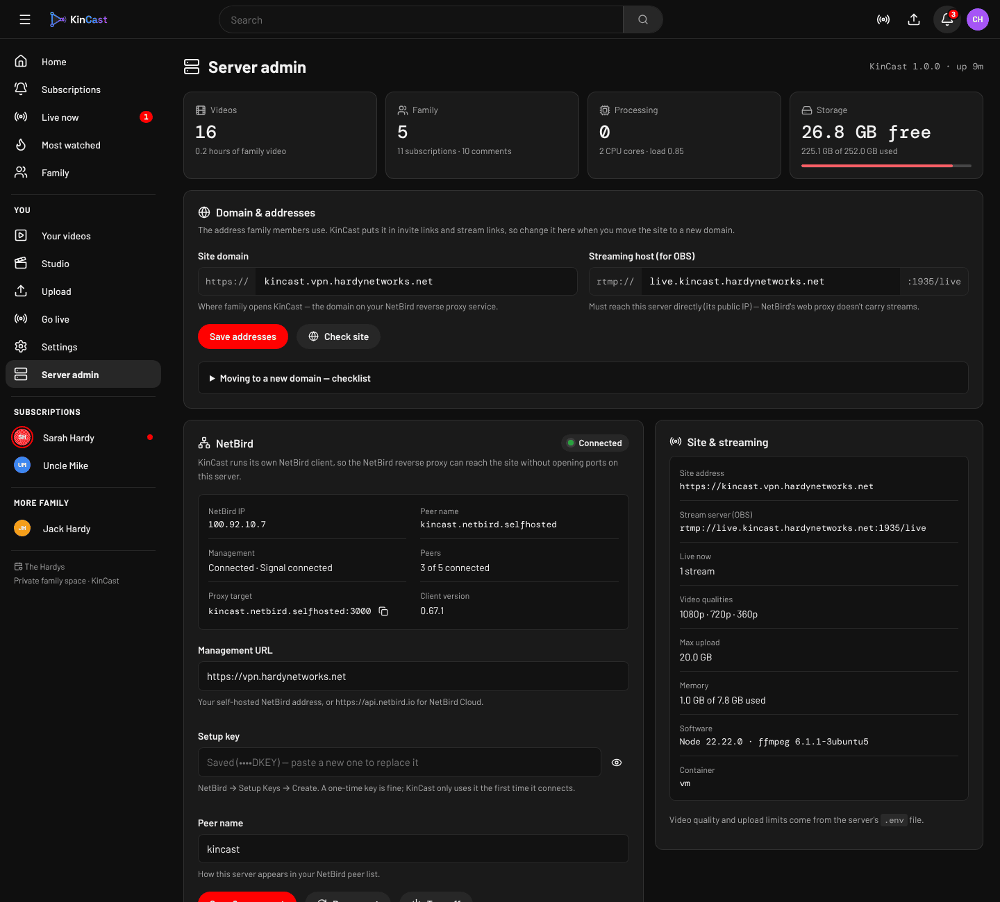<br><sub><b>Server admin</b> — storage and processing at a glance, domain settings, built-in NetBird client.</sub></td>
    <td>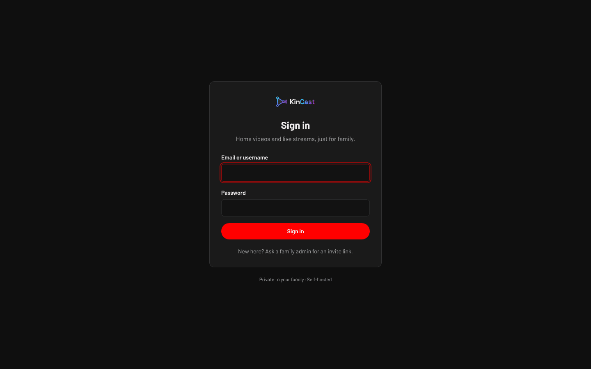<br><sub><b>Private by default</b> — family members join with an invite link.</sub></td>
  </tr>
</table>

<p align="center">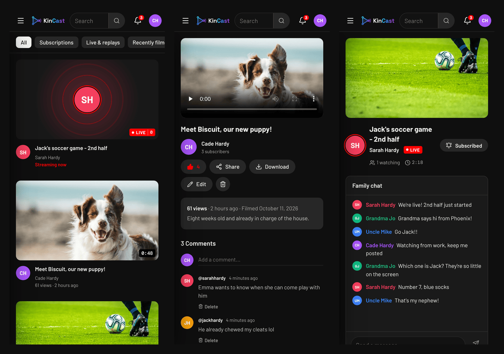<br><sub>Works on phones too — home, watch and live.</sub></p>

## Features

- **Home videos** — drag-and-drop multi-file uploads (sent in pieces, so 10+ GB files get through proxies like Cloudflare), automatic conversion to adaptive streaming (1080p / 720p / 360p), portrait phone video handled properly, thumbnails, and original-file download.
- **Memories** — the date a video was filmed is read from the phone's metadata or the filename, and the home page shows **On this day** videos from past years.
- **Live streaming** — each member gets a private stream key for OBS or a phone app. The live page has family chat, a viewer count and a timer, and streams are **saved as replays** automatically.
- **Subscriptions & notifications** — subscribe to family members to get their videos in a Subscriptions feed and the sidebar, plus a notification bell alert when they upload or go live.
- **Family** — invite links with roles (admin / member / viewer), a channel per person, likes, comments, search, and filters (recently filmed, most watched, per person…).
- **Server admin** — storage, processing queue and versions at a glance; change the site's domain without touching config files; connect the built-in **NetBird** client.
- **Private** — every page, video file and live stream requires sign-in. Stream keys never appear in playback links.

## Quick start

You need a Linux server with Docker and the Compose plugin. Images are built by GitHub Actions for amd64 and arm64.

```bash
sudo git clone https://github.com/hardynetworks/kintube.git /opt/kintube
cd /opt/kintube
sudo tee .env > /dev/null <<EOF
POSTGRES_PASSWORD=$(openssl rand -hex 24)
SESSION_SECRET=$(openssl rand -hex 32)
RTMP_CALLBACK_SECRET=$(openssl rand -hex 32)
COMPOSE_FILE=docker-compose.yml:docker-compose.netbird.yml
EOF
sudo docker compose pull
sudo docker compose up -d
```

Keep a copy of `.env` somewhere safe — the database password can't change after the first start.

Then pick how people reach the site:

### Option A — NetBird reverse proxy (recommended, no ports to open for the site)

KinCast runs its own NetBird client (the `netbird` container), so there's nothing to install on the server itself.

1. Reach KinCast once to create your account — e.g. an SSH tunnel: `ssh -L 3000:172.30.77.10:3000 you@your-server`, then open `http://localhost:3000`.
2. Create the family and your admin account, open **Server admin**, and enter your NetBird **management URL** and a **setup key** (NetBird → Setup Keys). It shows **Connected** within a minute.
3. In NetBird, **Reverse Proxy → Services → Add Service**: mode **HTTP**, your domain (e.g. `kincast.vpn.example.net`), target **Peer** → your KinCast peer (named `kintube` unless you changed it), port **3000**, authentication **none** (KinCast has its own logins), and a **Block access** rule for the path `/internal`.
4. In **Server admin → Domain & addresses**, enter the same domain and click **Check site**.

### Option B — Built-in HTTPS (Caddy)

Remove the `COMPOSE_FILE` line from `.env`, add `DOMAIN=kincast.example.com`, point that domain's DNS at the server, open ports **80** and **443**, and run `sudo docker compose up -d`. Caddy gets a certificate automatically.

### Both options: live streaming

OBS and phone apps connect straight to the server on **TCP 1935**, so:

- open **1935/tcp** in the server's firewall, and
- give it a hostname that points at the server's public IP — e.g. `live.example.net`, **DNS only** (grey cloud) if you use Cloudflare — and enter it under **Server admin → Domain & addresses → Streaming host**.

### On HardyOS (one click)

KinCast ships as a one-click app for [HardyOS](https://github.com/HARDYOS/HARDYOS).
Open **App Store › Discover › KinCast › Install**, or upload `kincast.hardyapp`
from a [release](https://github.com/hardynetworks/kintube/releases). HardyOS picks
free ports, generates the passwords, keeps the videos in their own ZFS dataset and
starts everything. The package lives in [`hardyos/`](hardyos/).

## Going live

**Go live** (in the sidebar) shows your server address and private stream key.

- **OBS:** Settings → Stream → Service **Custom…**, paste the server and stream key. Settings → Output: encoder **H.264** (x264 or a hardware *H.264* encoder such as "NVIDIA NVENC H.264"), 2500–6000 Kbps, keyframe interval **2 s**. A 1080p or 720p output is plenty for family viewers.
- **Phone:** an RTMP camera app such as Larix Broadcaster, with `rtmp://<streaming host>:1935/live/<stream key>`.

Streams are passed through without re-encoding (low CPU, ~6–10 s delay), so viewers get exactly what you send.

### If a stream shows "Connecting to the stream…"

KinCast shows you as live (so the stream key worked) but the video never starts:

1. **Check the encoder is H.264.** HEVC/H.265 and AV1 are accepted by the server but can't be turned into web video. OBS still says it's streaming fine.
2. Look at the streaming server's log while streaming: `sudo docker compose logs --tail=40 rtmp`
3. Check the video pieces are being written: `sudo docker compose exec rtmp sh -c 'ls -la /hls/*/'`

## Updating

```bash
cd /opt/kintube
sudo git pull
sudo docker compose pull
sudo docker compose up -d
```

Pin a version with `KINTUBE_TAG=1.0.0` in `.env` (pushing a `v1.0.0` git tag publishes one). To build from source instead of pulling: `sudo docker compose -f docker-compose.yml -f docker-compose.build.yml up -d --build`.

## Configuration

Set these in `.env`. Only the three secrets are required.

| Setting | Default | What it does |
|---|---|---|
| `POSTGRES_PASSWORD`, `SESSION_SECRET`, `RTMP_CALLBACK_SECRET` | — | Required secrets. Generate with `openssl rand -hex 32`. |
| `COMPOSE_FILE` | — | `docker-compose.yml:docker-compose.netbird.yml` turns on the NetBird client and turns off Caddy. |
| `DOMAIN` | — | Site domain. Needed for Caddy; otherwise optional (set it in Server admin). |
| `RTMP_HOST` | `DOMAIN` | Hostname OBS connects to (also editable in Server admin). |
| `MAX_UPLOAD_GB` | `20` | Largest single upload. |
| `TRANSCODE_RENDITIONS` | `1080,720,360` | Qualities made for each upload. Fewer = faster and less disk. |
| `X264_PRESET` | `veryfast` | Processing speed vs. quality (`ultrafast` … `medium`). |
| `KEEP_ORIGINALS` | `true` | Keep the original file so family can download it. |
| `UPLOAD_CHUNK_MB` | `32` | Upload piece size. Lower it if a proxy rejects uploads with "413". |
| `HTTP_PORT`, `HTTPS_PORT` | `80`, `443` | Caddy's ports. |
| `KINTUBE_TAG` | `latest` | Image version to run. |
| `KINTUBE_SUBNET`, `APP_IP` | `172.30.77.0/24`, `.10` | Internal Docker network; change only if it clashes with another network. |

## How it works

```
 OBS / phone ──RTMP :1935──▶ rtmp (nginx-rtmp) ──on_publish──▶ app: checks the key, renames the stream to a public id
                                  │  records .flv ──on_record_done──▶ app: saves it as a replay video
                                  └─ HLS ──▶ hls volume ◀── served by app (sign-in required)

 Browser ──HTTPS──▶ NetBird reverse proxy ──▶ netbird (peer) ──▶ app (Node/Express + React) ──▶ postgres
              (or Caddy on 80/443)                                 └─ ffmpeg worker: uploads → adaptive HLS
```

| Service | Image | What it is |
|---|---|---|
| `app` | `ghcr.io/hardynetworks/kintube` | Node 22 + Express API, React web app, ffmpeg video processing |
| `rtmp` | `ghcr.io/hardynetworks/kintube-rtmp` | nginx-rtmp: stream ingest, HLS packaging, recording |
| `netbird` | `ghcr.io/hardynetworks/kintube-netbird` | NetBird client, configured from Server admin (Option A) |
| `caddy` | `caddy:2-alpine` | Automatic HTTPS (Option B) |
| `db` | `postgres:16-alpine` | Database |

## Server sizing

Video processing is the heavy part. A 4 vCPU server processes a 10-minute 1080p phone video in roughly 5–10 minutes with the default qualities. To go faster use `TRANSCODE_RENDITIONS=720,360` or `X264_PRESET=superfast`. Storage is about 1.5× the original size per video with `KEEP_ORIGINALS=true`. Live streams use almost no CPU.

## Backups

Back up the database and the `data` volume:

```bash
cd /opt/kintube
sudo docker compose exec db pg_dump -U kincast kincast > kincast.sql
sudo docker run --rm -v kintube_data:/data -v "$PWD":/b alpine tar czf /b/kincast-media.tgz /data
```

## Local development

```bash
# Postgres on localhost:5432 with user/db "kincast"
cd server && npm install && npm run dev        # API on :3000
cd web && npm install && npm run dev           # UI on :5173 (proxies to :3000)
```

For live testing, build `rtmp/` and run it with `-p 1935:1935 -e RTMP_CALLBACK_SECRET=... -e APP_UPSTREAM=http://host.docker.internal:3000`.

## Brand

`brand/` has the logo: dark and light lockups, the mark, app icon and favicons (SVG, PNG, ICO). The mark is three connected nodes — the family — forming a play button, with broadcast waves for live. Logo colors: cyan `#22D3EE` → indigo `#6366F1` → magenta `#C026D3`.

The interface follows the "Video sharing app" Figma Make design: near-black `#0f0f0f`, greys `#1a1a1a` / `#272727`, red accent `#ff0000`, with Barlow, Barlow Condensed and DM Mono (self-hosted).

Screenshot photos are from [Unsplash](https://unsplash.com).

## Known limits and ideas

- One family per install.
- iPhone HDR (Dolby Vision / HLG) videos are converted to standard range and may look a little flat.
- Live streams are single-quality, and must be sent as H.264.
- Ideas: albums/playlists, email notifications, Authentik/OIDC login, Chromecast.
