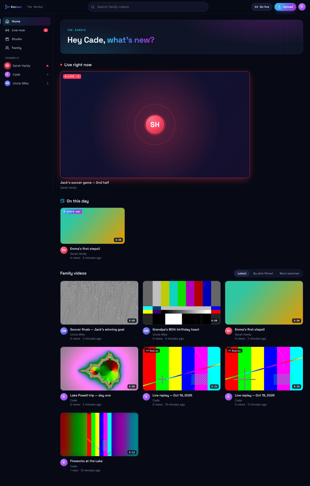

<p align="center"></p>

<p align="center"><a href="https://github.com/hardynetworks/kintube/actions/workflows/docker.yml"></a></p>

<p align="center"></p>

# KinCast

A private, self-hosted YouTube for your family: share home videos, watch them on any device, and go live for recitals, birthdays and games — with family chat. Inspired by Open Streaming Platform and Owncast, rebuilt as its own app.

## Features

- **Home videos** — drag-and-drop multi-file uploads (chunked, so 10+ GB files work through Cloudflare), automatic transcoding to adaptive HLS (1080p/720p/360p), portrait phone video handled properly, thumbnails, original-file download.
- **Memories** — "date filmed" is read from phone metadata or the filename; the home page shows **On this day** videos from past years.
- **Live streaming** — each member gets a private stream key for OBS or a phone app (Larix). Live page with family chat, viewer count and timer. Streams are **auto-saved as replays**.
- **Family** — invite links (admin / member / viewer roles), channels per person, likes, comments, search, sort by date filmed.
- **Private** — everything (pages, video files, live streams) requires sign-in. Stream keys never appear in playback URLs.

## Architecture

```
 OBS / phone ──RTMP:1935──▶ rtmp (nginx-rtmp) ──on_publish──▶ app: checks key, renames stream to public id
                                  │  records .flv  ─on_record_done─▶ app: turns it into a replay video
                                  └─ HLS ─▶ /hls volume ◀── served by app (auth required)
 Browser ──HTTPS──▶ caddy ──▶ app (Node/Express + React)  ──▶ postgres
                                  └─ ffmpeg worker: uploads → /data/media/<id>/hls (ABR)
```

| Service | What it is |
|---|---|
| `app` | Node 22 + Express API, React web app, ffmpeg transcoder |
| `rtmp` | nginx + nginx-rtmp: stream ingest, HLS packaging, recording |
| `db` | Postgres 16 |
| `caddy` | HTTPS reverse proxy (automatic certificates) |

## Deploy on a cloud server

Every push to `main` builds two images with GitHub Actions and publishes them to GHCR (amd64 + arm64):

- `ghcr.io/hardynetworks/kintube` — the app
- `ghcr.io/hardynetworks/kintube-rtmp` — the streaming ingest

1. **DNS (Cloudflare)**
   - `kintube.example.com` → server IP (proxied/orange cloud is fine; set SSL/TLS to **Full (strict)**).
   - `live.kintube.example.com` → server IP, **DNS only (grey cloud)** — Cloudflare's proxy doesn't carry RTMP.
2. **Firewall:** open 80, 443 and 1935/tcp.
3. **Install Docker** (with the compose plugin), then:
   ```bash
   git clone https://github.com/hardynetworks/kintube.git && cd kintube
   cp .env.example .env
   nano .env   # DOMAIN, RTMP_HOST, and three secrets from: openssl rand -hex 32
   docker compose pull
   docker compose up -d
   ```
4. Open `https://kintube.example.com` — the first visit walks you through creating the family and your admin account. Then **Family → Create invite link** and text it to everyone.

**Updating:** `git pull && docker compose pull && docker compose up -d`. Pin a release with `KINTUBE_TAG=1.0.0` in `.env` (push a `v1.0.0` git tag to publish one).

**Build from source instead of pulling:** `docker compose -f docker-compose.yml -f docker-compose.build.yml up -d --build`

**Already running a reverse proxy?** Set `HTTP_PORT`/`HTTPS_PORT` in `.env` to free ports (or remove the `caddy` service) and point your proxy at `app:3000` — just block `/internal/*` and turn off response buffering for `/api/live/*` (chat uses Server-Sent Events).

### Going live
Studio → **Go live** shows the server URL and your stream key. In OBS: Settings → Stream → Custom, paste both, keyframe interval 2s, ~3000 Kbps. On a phone, use Larix Broadcaster with `rtmp://live.your-domain:1935/live/<key>`.

Live streams are passed through without re-encoding (low CPU, ~6–10 s delay), so viewers get the quality you send.

## Sizing

Transcoding is the heavy part. A 4 vCPU VPS processes a 10-minute 1080p phone video in roughly 5–10 minutes with the default ladder. To go faster: `TRANSCODE_RENDITIONS=720,360` or `X264_PRESET=superfast`. Storage is ~1.5× the original per video with `KEEP_ORIGINALS=true`.

## Backups

Back up the `db` and `data` volumes, e.g.:
```bash
docker compose exec db pg_dump -U kincast kincast > kincast.sql
docker run --rm -v kincast_data:/data -v $PWD:/b alpine tar czf /b/kincast-media.tgz /data
```

## Local development

```bash
# Postgres on localhost:5432 with user/db "kincast"
cd server && npm install && npm run dev        # API on :3000
cd web && npm install && npm run dev           # UI on :5173 (proxies to :3000)
```
For live testing, build `rtmp/` and run it with `-p 1935:1935 -e RTMP_CALLBACK_SECRET=... -e APP_UPSTREAM=http://host.docker.internal:3000`.

## Brand

`brand/` holds the logo: dark/light lockups, the mark, app icon, favicon (SVG + PNG + ICO). The mark is three connected nodes (the family) forming a play button, with broadcast waves for live. Colors: cyan `#22D3EE` → indigo `#6366F1` → magenta `#C026D3` on navy `#070A14`. Type: Space Grotesk, Inter, JetBrains Mono.

## Known limits / ideas next

- One family per install.
- iPhone HDR (Dolby Vision/HLG) videos are converted to 8-bit SDR and may look a little flat.
- Live is single-quality; optional ABR transcoding for live is a natural next step.
- Ideas: albums/playlists, email notifications when someone goes live, Authentik/OIDC login, Chromecast.
