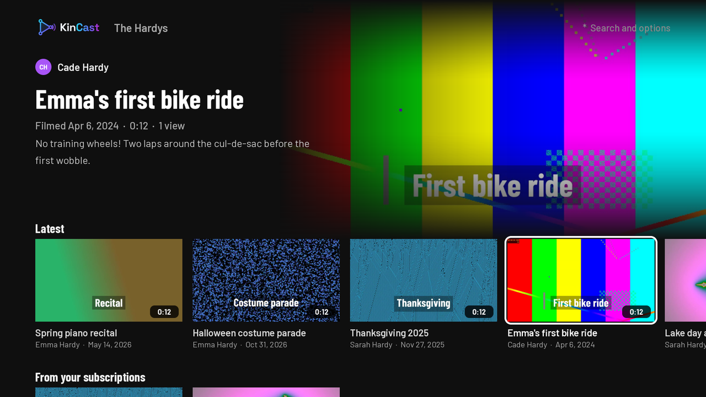
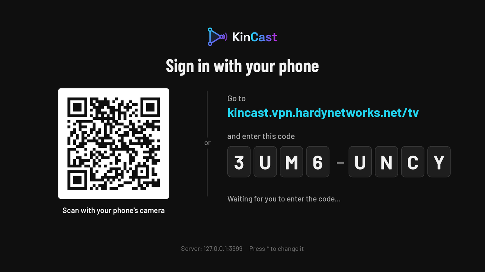

# KinCast for Roku TVs

A Roku channel for KinCast: the family's videos and live streams on the TV,
with family chat beside live streams. Works on Roku TVs (TCL, Hisense and
others) and Roku sticks, in HD and 4K.



## Install it on your TV

Roku only installs channels from its store, or one channel you "sideload" in
developer mode. KinCast isn't in the store, so it's sideloaded:

1. **Get the channel.** Download `kincast-roku.zip` from the latest
   [release](https://github.com/hardynetworks/kintube/releases) (or the
   *Roku channel* workflow's artifact). Don't unzip it.
2. **Turn on developer mode** with the TV's remote (not the phone app). On the
   Home screen press **Home 3 times, Up 2 times, Right, Left, Right, Left,
   Right**. Write down the IP address shown, choose **Enable installer and
   restart**, agree to the license, and set a password. The TV restarts.
3. **Install.** On a computer on the same Wi-Fi, open `http://<TV's IP>`,
   sign in as `rokudev` with that password, click **Upload**, choose
   `kincast-roku.zip`, then **Install with zip**. KinCast opens on the TV.

KinCast stays on the Home screen after that. To update, install a newer zip
the same way: the TV keeps its sign-in. Only one sideloaded channel can be
installed at a time; installing a different one replaces KinCast.

## First run

1. **Address.** Type the address you open KinCast at in a browser, e.g.
   `kincast.example.net` (https is assumed) or a home-network address like
   `192.168.1.20:8095` (http is assumed). The TV must be able to reach it.
2. **Sign in with your phone.** The TV shows a QR code and a code. Scan the
   QR code, or open `<your KinCast>/tv` and type the code, and press
   **Connect TV**. The TV signs in by itself.



The TV watches as the person who connected it, but can't upload, go live or
change anything. See and remove connected TVs in KinCast's **Settings › TVs**.

## Using it

- **Home**: Live now, Latest, From your subscriptions, On this day, and the
  family. The focused video is shown large at the top.
- **OK** on a video opens it; **Play** or **Resume** (KinCast remembers where
  you stopped), or **More from** that person.
- **Live streams** play with family chat on the right; **\*** hides it. The
  TV notices when the stream ends.
- **\*** on Home: Search, Refresh, Sign out of this TV, Change server.

## Developing

```bash
cd roku
npm ci
npm run check   # BrighterScript compile check
npm test        # BrightScript unit tests (brs-node)
npm run build   # out/kincast-roku.zip
python3 tools/make_art.py   # regenerate images/ and fonts/ from ../brand
```

The channel is plain SceneGraph/BrightScript (`components/`). It talks to the
KinCast API with a bearer token from the TV pairing flow
(`server/src/routes/tv.js`); posters and the video player send it through
an `roHttpAgent`, since thumbnails and HLS are only served to the family.
